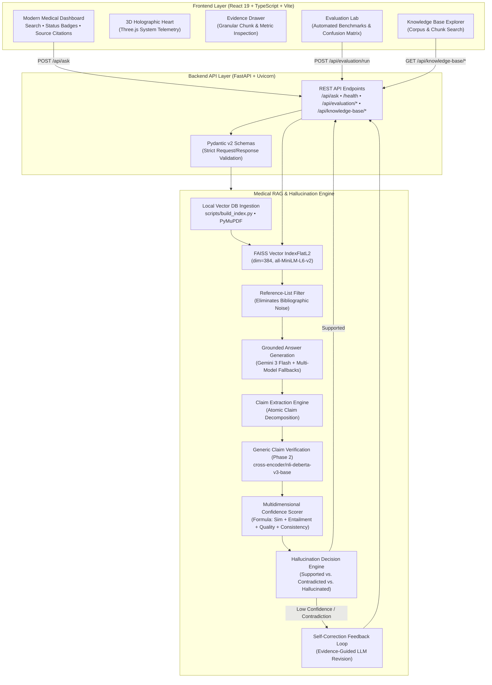
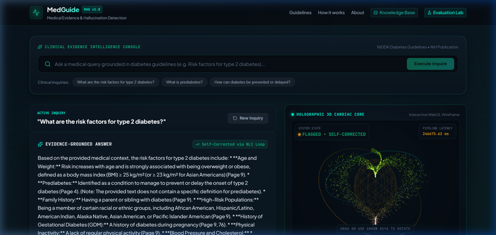
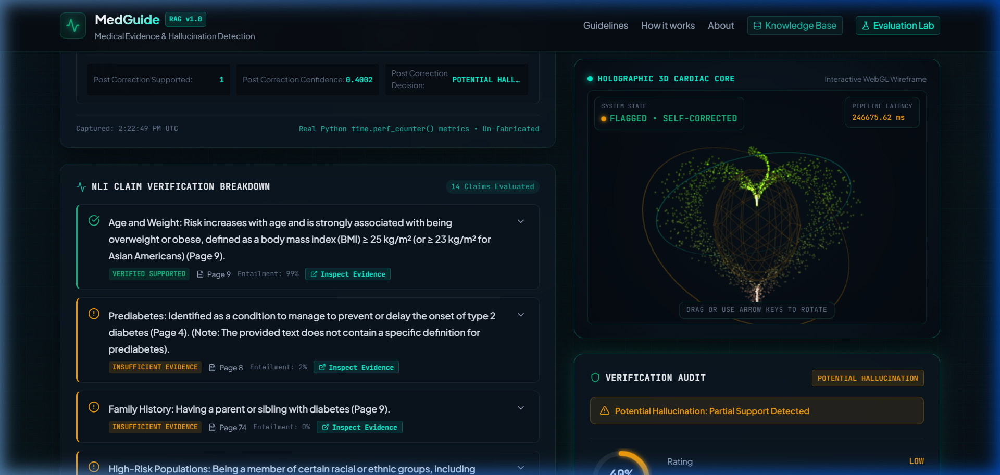
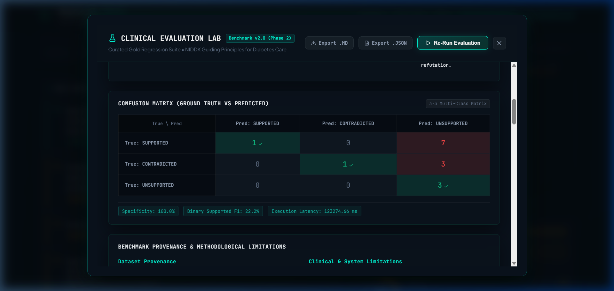
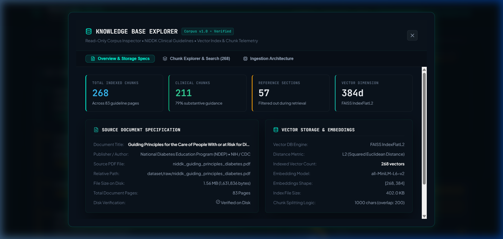

<div align="center">

# 🩺 Medical RAG — Hallucination Detection System

### Evidence-grounded Medical AI Assistant with Retrieval, Verification, Confidence Scoring & Self-Correction.

[](https://www.python.org/)
[](https://www.langchain.com/)
[](https://github.com/facebookresearch/faiss)
[](https://www.sbert.net/)
[](https://fastapi.tiangolo.com/)
[](https://react.dev/)
[](https://ai.google.dev/)

</div>

---

## 🩺 Overview

**Medical RAG Hallucination Detection** is a Retrieval-Augmented Generation (RAG) based Medical AI Assistant designed to generate answers from trusted medical documents while checking whether the generated response is sufficiently supported by the retrieved evidence.

The system combines:

- Medical document retrieval
- Grounded LLM answer generation
- Evidence-based claim verification
- Hallucination detection
- Confidence scoring
- Self-correction

The core idea is:

> **Retrieve → Generate → Verify → Score → Correct → Respond**

The current prototype uses a trusted medical guideline PDF related to diabetes as its primary knowledge source.

---

## 🎯 Project Objective

The goal of this project is to build a medical AI assistant that:

- Answers questions using trusted medical documents.
- Grounds generated responses in retrieved evidence.
- Detects potentially unsupported or contradictory claims.
- Calculates a confidence score for generated answers.
- Performs self-correction when an answer is unreliable.
- Provides source and page-level evidence for verification.

The system is designed to reduce the risk of hallucinated medical information by making retrieved evidence an explicit part of the answer-generation and verification pipeline.

---

## 👥 Team

- **Vivek**
- **Mansi**

### Work Division

**Vivek**
- Dataset collection and preparation
- Trusted source-document organization
- Dataset management
- Overall pipeline review
- Documentation
- Integration
- Final testing

**Mansi**
- LLM integration
- Hallucination detection
- Confidence scoring
- Self-correction
- Backend and integration coding


---

## 🛠️ Tech Stack

| Category | Technology |
|---|---|
| Language | Python |
| LLM | Google Gemini API |
| RAG Framework | LangChain |
| Embeddings | Sentence Transformers |
| Embedding Model | `all-MiniLM-L6-v2` |
| Vector Database | FAISS |
| PDF Processing | PyMuPDF |
| Hallucination Detection | NLI + Semantic Similarity |
| NLI Model | `cross-encoder/nli-deberta-v3-base` |
| Backend | FastAPI |
| Frontend | React |
| Styling | Tailwind CSS |
| Development | VS Code |
| Experimentation | Google Colab |
| Version Control | Git & GitHub |

---

# 📁 Project Structure

```text
Medical-RAG-Hallucination-Detection/
│
├── assets/
│
├── backend/
│
├── dataset/
│   ├── raw/
│   │   └── niddk_guiding_principles_diabetes.pdf
│   └── .gitkeep
│
├── docs/
│   ├── PROJECT_PLAN.md
│   ├── ROADMAP.md
│   ├── TEAM_GUIDELINES.md
│   └── TEAM_HANDOFF.md
│
├── frontend/
│
├── models/
│
├── notebooks/
│   ├── Notebook_01_Project_Setup.ipynb
│   ├── Notebook_02_Environment_Setup.ipynb
│   ├── Notebook_03_PDF_Text_Extraction.ipynb
│   ├── Notebook_04_LLM_Integration.ipynb
│   ├── Notebook_05_Hallucination_Detection.ipynb
│   ├── Notebook_06_Confidence_Scoring.ipynb
│   ├── Notebook_07_Self_Correction.ipynb
│   └── Notebook_08_Pipeline_Integration.ipynb
│
├── outputs/
├── presentation/
├── research/
├── screenshots/
├── scripts/
├── tests/
├── vector_db/
│
├── .gitignore
├── LICENSE
└── README.md
```

---

## 📓 Notebook Experimental Phase (Notebooks 01–08)

The initial experimental and model-development phase was prototyped and validated in Google Colab through Notebooks 01 to 08 before transitioning to the production full-stack architecture.

Notebook 01 — Project Setup

notebooks/Notebook_01_Project_Setup.ipynb

Handles initial project setup and repository verification.

Status

✅ Completed

Notebook 02 — Environment Setup

notebooks/Notebook_02_Environment_Setup.ipynb

Prepares and verifies the Python/ML development environment.

Status

✅ Completed

Notebook 03 — PDF Text Extraction & FAISS Retrieval

notebooks/Notebook_03_PDF_Text_Extraction.ipynb

Implements the document processing and retrieval foundation.

Workflow
Medical PDF
     ↓
PDF Text Extraction
     ↓
Text Cleaning
     ↓
Text Chunking
     ↓
Sentence Embeddings
     ↓
FAISS Vector Index
     ↓
Similarity Retrieval
Status

✅ PDF loading
✅ Text extraction
✅ Text cleaning
✅ Text chunking
✅ Embedding generation
✅ FAISS indexing
✅ Similarity retrieval

Current Source Document
dataset/raw/niddk_guiding_principles_diabetes.pdf
Document Information
Type: Medical diabetes guideline
Pages: 83
Chunk size: 1000 characters
Chunk overlap: 200 characters
Embedding dimension: 384
Vector database: FAISS
🤖 Notebook 04 — LLM Integration

notebooks/Notebook_04_LLM_Integration.ipynb

Integrates the retrieved medical context with the Gemini LLM.

Workflow
User Question
      ↓
FAISS Retrieval
      ↓
Relevant Medical Context
      ↓
Grounded Prompt
      ↓
Gemini LLM
      ↓
Evidence-based Answer

The model is instructed to answer using the retrieved medical context rather than relying only on internal knowledge.

The pipeline also supports abstention when sufficient evidence is not available.

Status

✅ Gemini integration
✅ Grounded prompting
✅ Context-based answer generation
✅ Insufficient-evidence handling
✅ Retry handling for temporary API errors

🔍 Notebook 05 — Hallucination Detection

notebooks/Notebook_05_Hallucination_Detection.ipynb

This stage checks whether generated answers are supported by retrieved medical evidence.

Two complementary signals are used:

1. Semantic Similarity

Measures how closely the generated answer is related to retrieved medical documents.

2. Natural Language Inference

The retrieved medical evidence is treated as the premise and the generated statement as the hypothesis.

The NLI model evaluates:

Entailment
Contradiction
Neutrality
Support Score

The initial answer-level verification uses:

Support Score =
0.5 × Semantic Similarity
+
0.5 × NLI Entailment

The claim-level verification stage later uses an NLI-first evidence score.

Detection Categories
SUPPORTED
CONTRADICTED
POTENTIAL HALLUCINATION
Status

✅ Semantic similarity verification
✅ NLI verification
✅ Contradiction detection
✅ Claim-level verification
✅ Hallucination classification

📊 Notebook 06 — Confidence Scoring

notebooks/Notebook_06_Confidence_Scoring.ipynb

The system calculates an overall confidence score using multiple signals.

Confidence Formula
Confidence =
0.30 × Answer Semantic Similarity
+
0.30 × NLI Entailment
+
0.20 × Retrieval Quality
+
0.20 × Claim Consistency
Confidence Levels
≥ 0.80  → HIGH
≥ 0.60  → MEDIUM
< 0.60  → LOW

Confidence is used as an additional signal for deciding whether an answer should be corrected.

Status

✅ Confidence calculation
✅ Retrieval quality calculation
✅ Claim consistency
✅ Confidence bands
✅ Self-correction trigger logic

🔄 Notebook 07 — Self-Correction

notebooks/Notebook_07_Self_Correction.ipynb

This stage introduces a feedback loop for unreliable answers.

Workflow
Generated Answer
      ↓
Evidence Verification
      ↓
Confidence + Hallucination Decision
      ↓
Reliable?
   ↙       ↘
 YES        NO
  ↓          ↓
Return    Self-Correction
Answer       ↓
          Evidence
          Based
          Revision

The correction process identifies unsupported claims and provides the available evidence to the LLM so that the answer can be revised using only supported information.

Status

✅ Unsupported claim identification
✅ Evidence collection
✅ Correction prompt generation
✅ Self-correction logic
✅ Correction pipeline testing

🔗 Notebook 08 — Pipeline Integration

notebooks/Notebook_08_Pipeline_Integration.ipynb

This is the final notebook of the experimental development phase.

It combines the major components developed in the previous notebooks into one pipeline.

Integrated Workflow
User Question
      ↓
Document Retrieval
      ↓
Medical Context Construction
      ↓
Grounded LLM Generation
      ↓
Claim Extraction
      ↓
Evidence Retrieval
      ↓
NLI Verification
      ↓
Confidence Scoring
      ↓
Hallucination Decision
      ↓
Self-Correction
      ↓
Final Answer
Current Pipeline Components

✅ Retrieval
✅ Context construction
✅ Grounded answer generation
✅ Claim extraction
✅ Claim-level evidence verification
✅ NLI-based verification
✅ Confidence scoring
✅ Hallucination decision
✅ Self-correction trigger
✅ Integrated pipeline function

Current Validation

The integrated pipeline was tested using diabetes-related medical questions.

The verification pipeline successfully demonstrated:

Evidence retrieval
Supported claim detection
Unsupported claim detection
Confidence calculation
Hallucination classification
Self-correction logic

The final end-to-end Gemini generation test may be limited by external Gemini API quota availability during development.

## 🧠 Full-Stack System Architecture

MedGuide AI implements a decoupled, production-grade architecture uniting an interactive React 19 frontend with a FastAPI backend, localized FAISS vector retrieval, Hugging Face cross-encoders, and Google Gemini LLMs:



📚 Dataset

The current prototype uses a trusted medical guideline document related to diabetes.

Current Source
dataset/raw/niddk_guiding_principles_diabetes.pdf
Document

NIDDK Guiding Principles for the Care of People With or at Risk for Diabetes

The document is processed through:

PDF
 ↓
Extraction
 ↓
Cleaning
 ↓
Chunking
 ↓
Embedding
 ↓
FAISS Index
 ↓
Retrieval

The project is currently based on public medical guideline material and does not use private patient data.

📌 Evidence Grounding

A central design principle of the system is that medical answers should be grounded in retrieved evidence.

Each retrieved chunk contains metadata such as:

Chunk ID
Page number
Source document
Retrieved text
Similarity information

This allows generated claims to be compared against specific medical evidence.

---

## 🚀 Key Platform Features & Modules

### 1. Evidence-Grounded Medical Q&A
* Ingests clinical guidelines and splits them into clean character chunks (size: 1000, overlap: 200).
* Employs `all-MiniLM-L6-v2` dense embeddings to retrieve top-k clinical evidence chunks via FAISS vector search.
* Uses an intelligent citation heuristic filter (`is_reference_chunk`) to eliminate bibliography lists and raw citations, preventing reference dilution.
* Synthesizes clinically grounded answers via Google Gemini 3 Flash with automated model fallbacks (`gemini-flash-lite-latest`, `gemini-2.0-flash`) and API error sanitization.

### 2. Generic Claim Verification Engine (Phase 2)
* Deconstructs multi-sentence LLM responses into atomic medical claims using linguistic heuristics and regex tokenization.
* Converts generic medical claims into testable premise-hypothesis pairs.
* Employs `cross-encoder/nli-deberta-v3-base` to evaluate entailment, contradiction, and neutrality against retrieved clinical evidence.
* Computes claim consistency and flags contradictions before answers reach the user.

### 3. Multidimensional Confidence Scoring & Self-Correction
* Calibrated confidence scoring formula:
  $$\text{Confidence} = 0.30 \times \text{Semantic Sim} + 0.30 \times \text{NLI Entailment} + 0.20 \times \text{Retrieval Quality} + 0.20 \times \text{Claim Consistency}$$
* Confidence Bands:
  * $\ge 0.80$ : **HIGH** (Grounded and verified)
  * $\ge 0.60$ : **MEDIUM** (Partially supported, advisory warning)
  * $< 0.60$ : **LOW** (Potential hallucination / unsupported)
* **Automated Self-Correction:** When an answer contains contradicted claims, low consistency (< 0.60), or falls below the confidence threshold (< 0.60), the system triggers an evidence-guided feedback loop instructing the LLM to revise the answer using strictly supported facts or cleanly abstain.

### 4. Interactive Evaluation Lab & Benchmark Suite
* Built-in benchmark suite of verified medical test questions across supported, contradictory, and unsupported edge cases.
* On-demand calculation of precision, recall, F1-score, specificity, and confusion matrix.
* One-click export of structured evaluation reports as serialized JSON or formatted Markdown.

### 5. Knowledge Base Explorer
* Complete visibility into the indexed clinical corpus (`dataset/raw/niddk_guiding_principles_diabetes.pdf`).
* Dynamic corpus statistics: total chunks (268), embedding dimension (384), average chunk length, and clinical vs. reference chunk distribution.
* Searchable and paginated chunk inspector with metadata previews and direct source citations.

### 6. Holographic Heart Telemetry & Evidence Drawer
* Interactive Three.js 3D Holographic Heart visualizer that reflects real-time system verification health.
* Expandable Evidence Drawer displaying granular similarity distances, NLI logits, and page citations.

---

## 📸 Application Interface & Visual Showcase

The MedGuide AI user interface is a responsive, dark-mode clinical workstation built with React 19, TypeScript, Tailwind CSS, and Three.js telemetry. The interface provides end-to-end transparency across retrieval, generation, NLI claim verification, and empirical benchmark evaluation.

### 1. Clinical Evidence Intelligence Console & Telemetry

*Figure 1: Main clinical dashboard showing an answered diabetes inquiry with inline page citations (`[p.9]`, `[p.4]`), the self-correction status badge, and the interactive 3D Holographic Heart telemetry wireframe indicating real-time system state (`FLAGGED • SELF-CORRECTED`).*

### 2. NLI Claim Verification & Evidence Audit Drawer

*Figure 2: Granular claim-level verification view decomposing the response into 14 atomic clinical assertions, evaluating DeBERTa-v3 NLI entailment probabilities, and displaying the multidimensional confidence score (40% LOW) and hallucination classification.*

### 3. Clinical Evaluation Lab & Benchmark Matrix

*Figure 3: Interactive Evaluation Lab modal showing Benchmark v2.0 (Phase 2) evaluation over 15 curated gold regression probes, highlighting the 3×3 multi-class confusion matrix (Supported, Contradicted, Unsupported) and 100% specificity metric.*

### 4. Knowledge Base Explorer & Chunk Telemetry

*Figure 4: Knowledge Base Explorer modal inspecting the active FAISS IndexFlatL2 vector database (268 total indexed chunks, 211 substantive clinical guidance chunks, 57 filtered bibliographic reference chunks across 83 pages of the NIDDK clinical guideline).*

---

## 💻 Windows-Friendly Local Quickstart Guide

Follow these steps to run MedGuide AI locally. The application runs on two separate local processes: the FastAPI backend server and the Vite React frontend.

### Prerequisites
* **Operating System:** Windows 10/11, macOS, or Linux
* **Python:** 3.10 to 3.12 (Tested on Python 3.12.5)
* **Node.js:** Node.js 18+ and npm (Tested on Node v20+)
* **API Key:** A Google Gemini API Key ([Get one free from Google AI Studio](https://aistudio.google.com/))

---

### Step 1: Clone the Repository
Open a terminal (PowerShell, Command Prompt, or Bash):
```powershell
git clone https://github.com/vivek28n/Medical-RAG-Hallucination-Detection.git
cd Medical-RAG-Hallucination-Detection
```

---

### Step 2: Backend Setup & Execution (Terminal 1)

1. **Create and Activate a Python Virtual Environment:**
   ```powershell
   python -m venv .venv
   .\.venv\Scripts\Activate.ps1
   ```
   *(For Command Prompt: `.venv\Scripts\activate.bat` | For Bash/macOS/Linux: `source .venv/bin/activate`)*

2. **Install Backend Dependencies:**
   ```powershell
   pip install -r backend/requirements.txt
   ```

3. **Configure Backend Environment Variables:**
   Copy the example environment file:
   ```powershell
   Copy-Item backend/.env.example backend/.env
   ```
   *(For Bash/Linux/macOS: `cp backend/.env.example backend/.env`)*

   Open `backend/.env` in your editor and add your Gemini API key:
   ```env
   # backend/.env
   GEMINI_API_KEY=your_actual_gemini_api_key_here
   GEMINI_MODEL_NAME=gemini-3-flash-preview
   # Optional: CORS_ORIGINS=http://localhost:5173,http://localhost:5174
   ```

4. **Generate the FAISS Vector Database (Mandatory on Fresh Clone!):**
   > [!IMPORTANT]
   > The pre-built vector database files (`vector_db/index.faiss`, `vector_db/metadata.json`) are generated locally from the tracked medical guideline PDF (`dataset/raw/niddk_guiding_principles_diabetes.pdf`) and are intentionally excluded from Git via `.gitignore`.
   >
   > On a fresh clone, you **must run the ingestion script once** before launching the server:
   ```powershell
   python scripts/build_index.py
   ```
   This script extracts text from the PDF, generates chunk embeddings with `all-MiniLM-L6-v2`, and creates the FAISS index in `vector_db/` (~30–45 seconds).

5. **Start the FastAPI Backend Server:**
   ```powershell
   cd backend
   uvicorn app.main:app --reload --host 127.0.0.1 --port 8000
   ```
   The backend will start at `http://127.0.0.1:8000`. You can verify health at `http://127.0.0.1:8000/health`.

---

### Step 3: Frontend Setup & Execution (Terminal 2)

1. **Open a new terminal** and navigate to the `frontend` directory:
   ```powershell
   cd frontend
   ```

2. **Configure Frontend Environment Variables:**
   Copy the example environment file:
   ```powershell
   Copy-Item .env.example .env
   ```
   *(For Bash/Linux/macOS: `cp .env.example .env`)*

   The default configuration connects to the local backend:
   ```env
   # frontend/.env
   VITE_API_BASE_URL=http://127.0.0.1:8000
   ```

3. **Install Node Dependencies:**
   ```powershell
   npm install
   ```

4. **Start the Vite Development Server:**
   ```powershell
   npm run dev
   ```
   Open your browser to `http://localhost:5173` to launch the MedGuide AI dashboard.

---

### 🌐 Expected Local URLs

| Service / Interface | Local URL | Description |
|---|---|---|
| **MedGuide AI Dashboard** | `http://localhost:5173` | React 19 Frontend Web Interface |
| **FastAPI Backend Root** | `http://127.0.0.1:8000` | REST API Server |
| **Health Check Endpoint** | `http://127.0.0.1:8000/health` | Real-time model & index readiness status |
| **Swagger Interactive Docs** | `http://127.0.0.1:8000/docs` | Auto-generated OpenAPI / Swagger UI |
| **ReDoc API Documentation** | `http://127.0.0.1:8000/redoc` | Alternative API reference documentation |

---

### 📦 First-Run Model Downloads & Hardware Footprint

* **Automated Hugging Face Downloads:**
  On the very first launch, FastAPI's lifespan event automatically downloads and caches two open-source models from Hugging Face Hub into `~/.cache/huggingface/hub`:
  1. `sentence-transformers/all-MiniLM-L6-v2` (~90 MB) — Dense embeddings
  2. `cross-encoder/nli-deberta-v3-base` (~500 MB) — Natural Language Inference
* **Network & Boot Time:**
  * First-time startup requires an active internet connection and takes ~30–60 seconds while downloading ~590 MB of weights.
  * Subsequent startups load directly from local disk cache in ~4–8 seconds.
* **Hardware & Memory Footprint:**
  * Active Runtime Memory: **~1.2 GB to 1.5 GB RAM** (smoothly runs on CPU; no dedicated GPU required).
  * Storage: ~1.5 GB disk space for Python virtual environment, dependencies, and cached model weights.

---

## 🧪 Automated Testing & Quality Assurance

MedGuide AI includes 5 automated backend unit/integration test suites along with frontend type checking and linting.

### Run All Backend Tests
Always execute backend test commands from the **repository root** (with your virtual environment active). If your terminal is currently inside the `backend/` directory from running the server, return to the root first using `cd ..`:

```powershell
python -m unittest discover -s tests -p "test_*.py"
```

### Run Individual Test Suites
* **API Endpoints & Pipeline Mock Suite:**
  ```powershell
  python -m unittest tests/test_api.py
  ```
* **Evaluation Lab & Metric Computations:**
  ```powershell
  python -m unittest tests/test_evaluation.py
  ```
* **Phase 2 Benchmark Evaluation Suite:**
  ```powershell
  python -m unittest tests/test_evaluation_phase2.py
  ```
* **Generic Claim Verification & Hypothesis Engine:**
  ```powershell
  python -m unittest tests/test_generic_claim_verification.py
  ```
* **Knowledge Base Explorer & Chunk Pagination:**
  ```powershell
  python -m unittest tests/test_knowledge_base.py
  ```

### Run Frontend Lint & Build Checks
From the project root:
```powershell
# ESLint check (0 errors, 0 warnings)
npm --prefix frontend run lint

# TypeScript compilation and production bundle build
npm --prefix frontend run build
```

---

## 🎯 Current Development Status & Completed Milestones

All planned development milestones for the full-stack architecture are completed:

- [x] **Milestone 1 — Project & Environment Setup** (Repository, Git workflow, Colab baseline)
- [x] **Milestone 2 — Medical Document Ingestion** (PDF parsing with PyMuPDF, recursive chunking)
- [x] **Milestone 3 — Dense Retrieval & Indexing** (Sentence Transformers, FAISS IndexFlatL2)
- [x] **Milestone 4 — Grounded LLM Generation** (Gemini 3 Flash, prompt engineering, retry/fallbacks)
- [x] **Milestone 5 — Hallucination Detection Engine** (DeBERTa v3 NLI cross-encoder, semantic similarity)
- [x] **Milestone 6 — Multidimensional Confidence Scoring** (Four-component scoring formula)
- [x] **Milestone 7 — Self-Correction Feedback Loop** (Evidence-guided iterative answer revision)
- [x] **Milestone 8 — End-to-End Pipeline Integration** (Notebook 08 experimental validation)
- [x] **Milestone 9 — FastAPI Production Backend** (Modular service architecture, lifespan caching, Pydantic schemas)
- [x] **Milestone 10 — React 19 Frontend Dashboard** (Interactive search, source citation drawer, Three.js heart)
- [x] **Milestone 11 — Generic Claim Verification (Phase 2)** (Linguistic claim extraction, hypothesis generation)
- [x] **Milestone 12 — Evaluation Lab & Benchmark Suite** (Precision, recall, confusion matrix, JSON/Markdown export)
- [x] **Milestone 13 — Knowledge Base Explorer** (Live chunk inspector, reference filter, corpus statistics)
- [x] **Milestone 14 — Automated Testing & Quality Verification** (5 test suites, 0 lint errors, clean build)

---

## ⚠️ Clinical & Research Limitations

To ensure scientific honesty and ethical deployment, the following boundaries of this system must be recognized:

1. **Single Clinical Guideline Scope:** The current knowledge base is specialized exclusively on the NIDDK Guiding Principles for Diabetes Care (83 pages, 268 chunks). The system is not trained to answer general medical, surgical, or pediatric questions outside diabetes management, and will correctly abstain when evidence is insufficient.
2. **Educational & Research Prototype Only:** This system is an academic research demonstration of evidence-grounded RAG, hallucination detection, and self-correction. It is **not** an FDA-cleared, CE-marked, or clinically validated medical device, and must **never** be used as a substitute for professional clinical judgment, diagnosis, or treatment.
3. **Cross-Encoder Context Truncation:** The `cross-encoder/nli-deberta-v3-base` model operates with a 384-token input window. Complex medical claims that rely on broader multi-paragraph contexts across distant chunk boundaries are bounded by individual chunk sizes (1000 characters).
4. **LLM API & Latency Dependency:** Answer generation and self-correction depend on external Google Gemini API availability. Network latency or upstream rate limits (HTTP 429) may occasionally trigger model retries.
5. **Absence of Patient-Specific Health Context:** The pipeline verifies statements against public clinical guidelines; it does not access or integrate electronic health records (EHR), lab histories, or individual patient contraindications.
6. **Heuristic Reference-List Filtering:** Bibliography chunks are filtered out using regular expression heuristics (`is_reference_chunk`). While effective for standard guideline formatting, non-standard citations in diverse clinical literature may require updated filtering rules.

---

## 🔐 Security & Secret Handling

* **API Keys & Secrets:**
  * Never commit `.env` files or API keys to version control.
  * Both `backend/.env` and `frontend/.env` are strictly excluded in `.gitignore`.
  * The backend's LLM retry service explicitly sanitizes error traces, redacting any occurrences of the API key before logging.
* **CORS Security:**
  * The backend restricts Cross-Origin Resource Sharing (CORS) to designated local development ports by default, preventing unauthorized cross-origin requests.

---

## 🤝 Git & GitHub Workflow

* **Working Branch:** All current development occurs on feature and fix branches (e.g., `fix/generic-claim-verification`).
* **Clean Commits:**
  ```powershell
  git status
  git add <specific-files>
  git commit -m "feat/fix: descriptive commit message"
  ```
  *(Never use `git add .` or `git add -A` to avoid accidentally staging local configuration or untracked assets).*

---

## 👥 Authors & Team Contributions

* **Vivek Nigam** ([@vivek28n](https://github.com/vivek28n))
  * Dataset curation, medical document preparation, and trusted source organization.
  * Ingestion pipeline, FAISS vector indexing, and chunk metadata architecture.
  * System architecture review, testing suites, documentation, and local execution setup.
* **Mansi**
  * LLM prompt engineering, Gemini API integration, and error fallback handlers.
  * Hallucination detection engine, DeBERTa NLI cross-encoder, and semantic scoring.
  * Multidimensional confidence scoring formula and evidence-guided self-correction logic.
  * Frontend/backend feature implementation and Phase 2 generic claim verification.

---

<div align="center">

🩺 **MedGuide AI — Medical RAG Hallucination Detection**  
*Retrieve → Generate → Verify → Score → Correct → Respond*  

Built with Python, LangChain, FAISS, Sentence Transformers, DeBERTa, FastAPI, React 19 & Google Gemini.

</div>